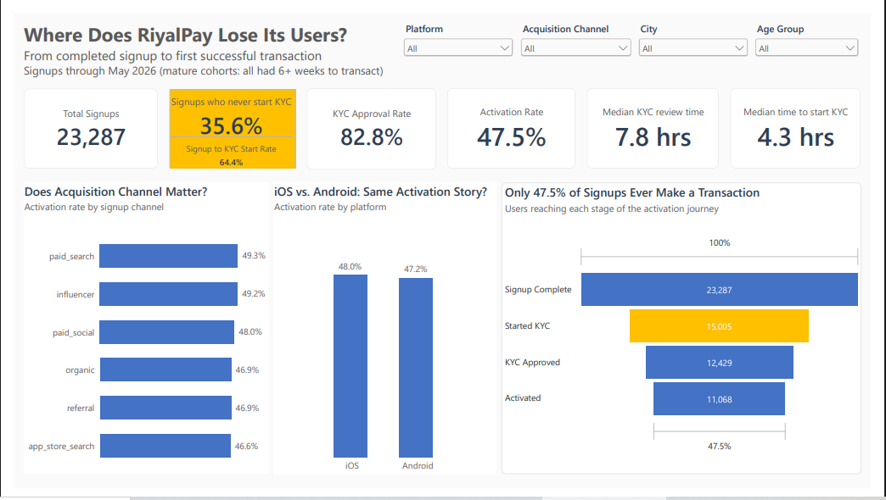
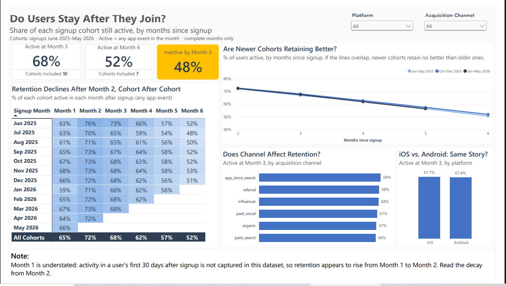
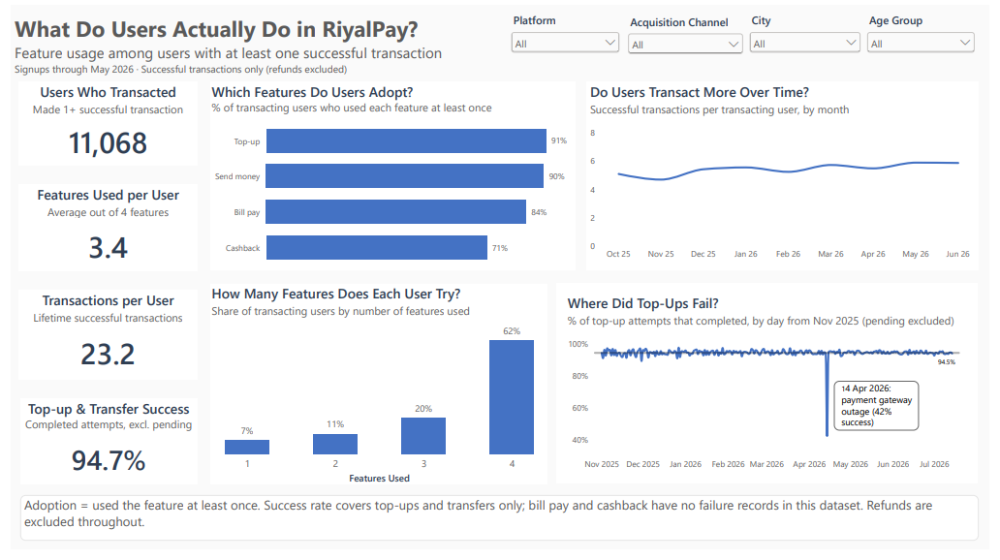
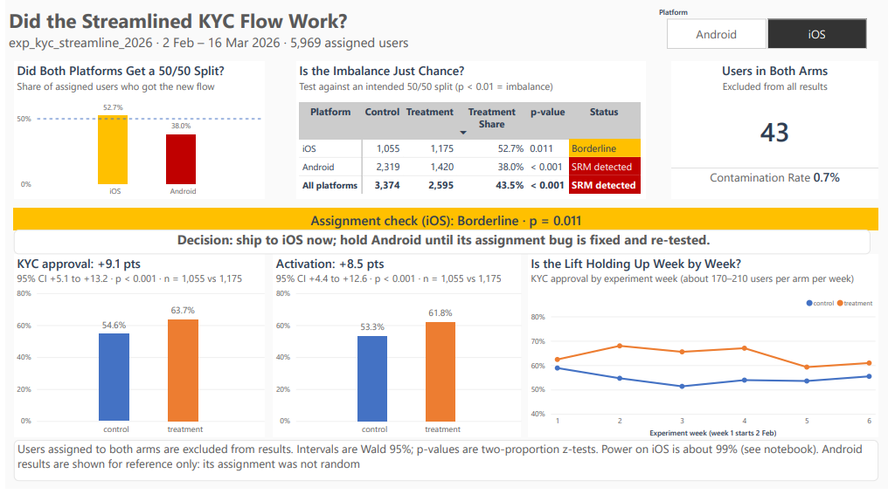

# RiyalPay: Product Analytics Case Study

**SQL · Python · Power BI · A/B testing · Event-data validation**

An end-to-end product analytics project for a **fictional** Saudi digital wallet. It covers tracking-plan validation, funnel and cohort analysis, a rigorous A/B-test readout, and a four-page Power BI dashboard for product stakeholders.

> RiyalPay is a fictional company, modeled on real wallets such as STC Pay and UrPay. All data is synthetic, generated for this project with deliberately realistic problems: duplicates, a mid-period analytics migration, bot traffic, tracking gaps and a broken experiment split.



## The business problem

RiyalPay launched in June 2025. Signups are healthy, but too few users become active, and an in-flight A/B test (`exp_kyc_streamline_2026`, a shortened KYC flow) needs a trustworthy read before rollout. The brief: validate the event data, diagnose the activation funnel, analyze the experiment properly, and recommend a go/no-go. The original analyst brief is in [`docs/RiyalPay_Project_Brief.pdf`](docs/RiyalPay_Project_Brief.pdf).

## What I found

| Question | Finding |
|---|---|
| Where does activation leak? | Of 23,287 signups (through May 2026), 64% start KYC, 53% are approved and 48% make a first transaction. The biggest leak is before KYC: **36% of signups never start it.** |
| Do users stay? | About 72% are active at Month 2 and 52% at Month 6, with the same pattern across channels, platforms and signup cohorts. |
| Which features get used? | Top-up 91%, Send money 90%, Bill pay 84% and Cashback 71% of transacting users. 62% use all four. |
| Is the product reliable? | About 95% of top-up and transfer attempts succeed. A payment-gateway outage on 14 Apr 2026 dropped top-up success to 42%. |
| Did the new KYC flow work? | On iOS, KYC approval rose **+9.1 pts** (95% CI +5.1 to +13.2) and activation **+8.5 pts**. Android's assignment was broken (38% treatment against 50% intended, p < 0.001), so its result is not trusted. |

**Recommendation: conditional go.** Ship the new flow to iOS; hold Android until the assignment bug is fixed and re-tested. Full write-up: [`docs/RiyalPay_Stakeholder_Recommendation.pdf`](docs/RiyalPay_Stakeholder_Recommendation.pdf).

## Dashboard

Four pages in [`Dashboard-RiyalPay.pbix`](Dashboard-RiyalPay.pbix), also exported as a [PDF](Dashboard-RiyalPay.pdf).

| Page | Question it answers |
|---|---|
| Activation Funnel | Where do users drop between signup and first transaction? |
| Cohort Retention | Do users stay after they join? |
| Feature Adoption | What do users actually do, and how reliable is it? |
| Experiment Results | Did the streamlined KYC flow work, and can we trust the test? |





## Skills demonstrated

| Skill | Where to look |
|---|---|
| Event data, tracking plans and validation | [`docs/RiyalPay_Tracking_Plan.pdf`](docs/RiyalPay_Tracking_Plan.pdf), `sql & py scripts/01_profiling.sql` (16 checks) |
| SQL on a 1.7M-row event table | `sql & py scripts/01` to `04` (CTEs, joins, conditional aggregation, funnel and cohort logic) |
| Data cleaning and reconciliation | `sql & py scripts/02_reconcile_and_clean.py` |
| Funnels, cohorts, retention, feature adoption | `sql & py scripts/03_funnel_cohort_analysis.sql`, dashboard pages 1 to 3 |
| Experimentation and hypothesis testing | [`notebooks/ab_test_analysis.ipynb`](notebooks/ab_test_analysis.ipynb): SRM check, contamination, z-tests, confidence intervals, power, weekly-effect test |
| Power BI and DAX | Star-schema model, dynamic titles, statistical tests in DAX (dashboard page 4) |
| Stakeholder communication | The two-page recommendation report, [`docs/RiyalPay_Stakeholder_Recommendation.pdf`](docs/RiyalPay_Stakeholder_Recommendation.pdf) |

## Data-quality issues found and handled

- Two event exports with different schemas (legacy SDK and Segment) reconciled into one table: renamed events, abbreviated property keys, naive local time converted to UTC.
- About 37K exact duplicate events and 336 duplicate user rows removed; inconsistent city spellings and currency labels normalized.
- Bot bursts landing on real user IDs, found with a temporal-integrity check and flagged at the event level.
- 344 users with KYC and transactions but no recorded signup events (a tracking gap), so the funnel is built with nested stages.
- A sample ratio mismatch on Android, and 43 users assigned to both experiment arms.
- Retention offsets computed in calendar months, with only complete months counted.

## Repository structure

```
├── docs/                                      Project brief, stakeholder recommendation, tracking plan (PDF)
├── notebooks/                                 Executed notebooks for every step, with outputs (load, profile, clean, analyze, export, A/B test)
├── powerbi_data/                              The eight CSVs the dashboard imports
├── screenshots/                               Dashboard page images used in this README
├── sql & py scripts/                          SQL and Python: load, profile, clean, analyze, export
├── Dashboard-RiyalPay.pbix                    The Power BI dashboard
└── Dashboard-RiyalPay.pdf                     PDF export of the dashboard
```

## Reproduce it

The raw data and the SQLite database are too large for the repository. Download `RiyalPay_synthetic_data.zip` from the [Releases](../../releases) page.

1. Make a working folder and copy in the files from `sql & py scripts/` plus the five `*_raw.csv` files from the zip.
2. Run `python 00_load_raw.py` to load the raw CSVs into `riyalpay.db`.
3. Run `01_profiling.sql` against `riyalpay.db` (DB Browser for SQLite works) to see the data-quality findings on the raw tables.
4. Run `python 02_reconcile_and_clean.py` to build the cleaned tables.
5. Run `03_funnel_cohort_analysis.sql` and `04_experiment_analysis.sql` against the same database.
6. Run `python build_powerbi_export.py` to regenerate the dashboard tables in `powerbi_data/`.
7. Open `notebooks/ab_test_analysis.ipynb` (it needs pandas, scipy, statsmodels and matplotlib) and point its database path at your `riyalpay.db`.

Every step also exists as an executed notebook in `notebooks/` (same code, outputs visible on GitHub), so you can read the results without running anything. They use file paths from the author's machine; change the path at the top of each notebook before running.

The `.pbix` imports its CSVs from a local path, so refreshing it elsewhere means re-pointing the data sources. The report pages display as they are.

## Limitations

- **Synthetic-data artifacts.** Users have no activity in the first 30 days after signup beyond onboarding, so Month 1 retention is understated and time-to-first-transaction is not analyzed. Feature choice is random per transaction, which is why adoption is high across the board.
- **Failure tracking.** Bill pay and cashback have no failure records, so the success rate covers top-ups and transfers only.
- **iOS balance check.** The iOS split passes narrowly (p = 0.011), so the recommendation includes monitoring after rollout.
